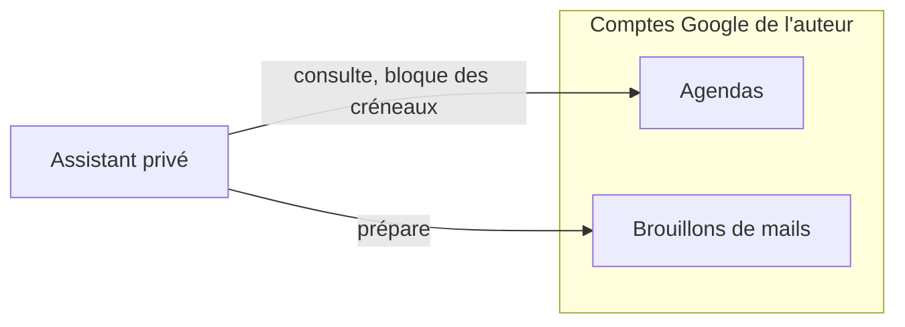

Ce dépôt contient les deux pages publiques de Life Dashboard, un outil personnel qui n'est pas proposé au public. L'outil permet à un assistant privé de consulter les agendas Google de son auteur, d'y bloquer des créneaux et de préparer des brouillons de mails dans ses propres comptes.

## Ce qu'il contient

| Page | À quoi elle sert | Fichier |
| --- | --- | --- |
| **Accueil** | Dit ce que fait l'outil et qu'il n'a pas d'autres utilisateurs | `index.html` |
| **Règles de confidentialité** | Les données consultées, leur usage, leur partage, leur conservation, et comment retirer l'accès | `privacy.html` |

Les deux pages sont en ligne : <https://may-1600.github.io/life-dashboard/>.

## Comment ça marche

L'outil n'envoie aucun mail. L'accès se retire à tout moment depuis le compte Google, comme l'indiquent les règles de confidentialité.

---

## Pour les développeurs

Deux pages HTML statiques, sans dépendance ni étape de construction. GitHub Pages les sert depuis la racine de `main` : un changement fusionné sur `main` est en ligne une fois la publication de GitHub Pages terminée.

La bannière se régénère depuis `.github/presentation.json`.
